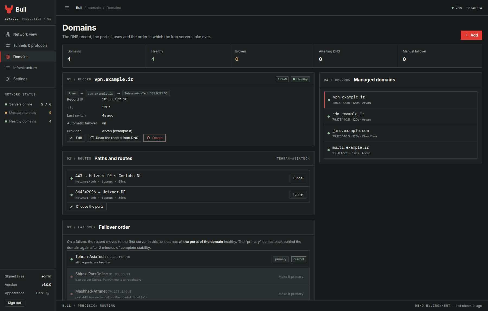
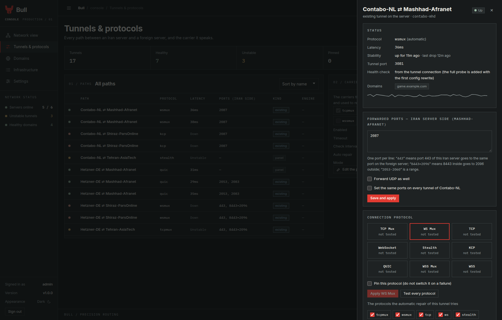
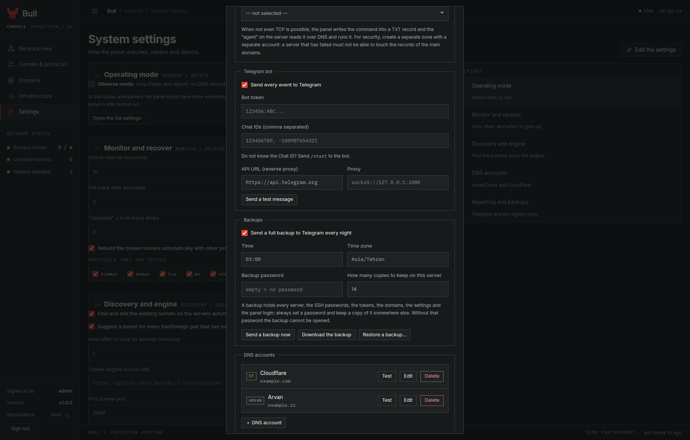

<p align="center">
  
</p>

**The control panel for reverse tunnels between Iranian and foreign servers.**
Bull-Tunn builds the tunnels, measures their health end to end, moves the
domain record to a healthy server when one dies, and reports everything to
**Telegram**.

Bull-Tunn is an independent tool: the tunnel engine, the panel and the
contract between them are all defined in this repository, and it depends on
no outside project.


## Contents

- [What it is](#what-it-is)
- [The panel](#the-panel)
- [Architecture](#architecture)
- [Features](#features)
- [Installation](#installation)
- [Installation with Docker](#installation-with-docker)
- [The panel on a domain with HTTPS](#the-panel-on-a-domain-with-https)
- [Migrating from the previous version](#migrating-from-the-previous-version)
- [Going live on real servers](#going-live-on-real-servers)
- [ArvanCloud and Cloudflare API keys](#arvancloud-and-cloudflare-api-keys)
- [The failover logic](#the-failover-logic)
- [The final exit of a port](#the-final-exit-of-a-port)
- [The tunnel engine](#the-tunnel-engine)
- [The command channel (DNS)](#the-command-channel-dns)
- [Backups and restore](#backups-and-restore)
- [The Telegram bot](#the-telegram-bot)
- [Updating](#updating)
- [Technical details](#technical-details)
- [Roadmap](#roadmap)

## What it is

Bull-Tunn keeps two things apart:

| | What it is | Where it runs | If it breaks |
|---|---|---|---|
| **The data plane** | The tunnel engine: the tunnel itself and the user traffic | On both servers of the tunnel | Only that tunnel goes down |
| **The control plane** | This panel: building, measuring, failing over, DNS, reporting | On one server outside Iran | No tunnel goes down |

The panel is never in the traffic path. If it is switched off, the tunnels
keep working exactly as before.

## The panel

The panel is one page with a sidebar, in two themes (**charcoal** and
**mineral paper**). Every page follows the same grammar: a title, a strip of
counters, numbered sections and a 1px line instead of a shadow. Every
number, every protocol and every address is written in a monospace face, so
that a column of figures can be read at a glance.

| Page | What it is for |
|---|---|
| **Network view** | The whole network as a graph: the foreign servers on the left, the Iran servers in the middle, the domains on the right. Free zoom and dragging, the layout is saved. Below it: the tunnel list and the event log. |
| **Tunnels & protocols** | Every path between an Iran server and a foreign server, with the carrier it speaks, its latency and the ports it carries. |
| **Domains** | The record, the ports it uses, the routes of every port and the order in which the Iran servers take over. |
| **Infrastructure** | The servers: their SSH, the tunnel engine on them, their tunnels and the ports they forward. |
| **Settings** | The working mode, the monitoring and the failover, the discovery of the tunnels, the DNS accounts, Telegram and the backups. |

The **line** of a path in the graph is its state, and the shape of the line
says it even without a colour: a solid line is a connected tunnel, a long
dash an unstable one, a short dash a broken one, a dash and a dot a tunnel
that is being tested, a directed dash a port that is forwarded to another
server, and a directed dotted line the route of a domain. A selection is
never a different colour but a red edge.

<p align="center">
  
</p>

## Architecture

```
   user ──► Iran server ──► tunnel ──► foreign server ──► the real service
              (public IP)

   panel ──SSH──► Iran server        panel ──HTTPS──► Cloudflare / Arvan
   panel ──SSH──► foreign server     panel ──HTTPS──► Telegram
```

The panel keeps **one SSH connection** open per server and does all of its
work (writing the config, starting and stopping the service, measuring the
health, reading the NAT rules) over that same connection. The full
explanation: [docs/architecture.md](docs/architecture.md).

## Features

- **A graphical workbench:** the foreign servers on the left, the Iran
  servers in the middle and the domains on the right. Free zoom and
  dragging, the layout is saved, and there is a dark and a light mode. The
  shape and the colour of a line are the state of the tunnel, and the
  protocol and the latency are written on it.
- **Five pages instead of one long screen:** the network, the tunnels, the
  domains, the servers and the settings, each with its own counters, so
  that nothing is hidden behind a drawer.
- **Finding the tunnels that already exist:** add the servers with their IP
  address and SSH access. The panel reads `/etc/bulltunn` and adds the
  running tunnels with the same name, protocol and ports.
- **A domain is an Iran server plus ports:** every port of a domain can go
  through its own tunnel to a different foreign server. The domain is only
  healthy when all of its ports are healthy.
- **Automatic failover:** on a failure or an instability, another tunnel on
  the same Iran server is tried first. Then the record moves to an Iran
  server that has all the ports healthy. After 10 minutes of stability the
  traffic returns to the primary server.
- **Switching the protocol with one click:** for example `tcpmux` to
  `wsmux`. Every protocol is tested, and the result and its latency are
  shown side by side.
- **Connection test ⚡:** in the panel of each server, the ⚡ button
  measures the path between that server and one on the other side **on
  every protocol**: the time to connect, the handshake time and the **real
  round trip** over the very path the tunnel goes through. The best
  protocol is proposed right away and can be applied to the tunnel with one
  click.
- **The final exit:** if a port is forwarded from a foreign server to
  another server (iptables, socat, gost, a relay and so on), the panel
  shows it.
- **Observe mode:** on until you switch it off yourself. In this mode the
  panel only watches and reports.
- **Nightly backup:** at 3 a.m., encrypted, sent to Telegram. The restore
  is done from inside the panel or from the command line.
- **Docker:** a ready-made image to run the panel on any host that has
  Docker.

| The path of the ports of a domain | Tunnels and protocols |
|---|---|
|  |  |

## Connection test ⚡

From the outside, the panel cannot know how good the path between two
servers is: the measurement has to be made **on the servers themselves**
and **over the very path the tunnel goes through**. That is why:

- The panel writes a temporary config on the foreign server and calls the
  tunnel engine with `probe`.
- The engine connects on **every protocol** in parallel and reports for
  each of them: the time to connect, the handshake time (the encryption)
  and the **real round trip** (three pings, the median is kept).
- The panel sorts the results: the fastest protocol that works is the
  "best" one.

The ⚡ button in the panel of each server does this: pick the server on
the other side, press ⚡, and look at the table. With "Apply" on the
tunnel, that protocol is pinned to the tunnel.

If the Iran server does not have a tunnel yet, the measurement is not
possible (there is no port to measure) and the panel says so.

<p align="center"></p>

## Installation

Install the panel on a server **outside Iran**: one of the foreign servers,
or a separate one. The panel must be able to reach the Telegram API, the
ArvanCloud and Cloudflare APIs, the source of the tunnel engine and every
server over SSH. Ubuntu 22.04 or later, with Python 3.10 or later.

The repository is **private**, so a token is needed to clone it:

```bash
# with a token (scope: repo, access: contents)
git clone https://<user>:<token>@github.com/Liwyd/Bull-Tunn.git
cd Bull-Tunn
sudo bash deploy/install.sh
```

Or with an SSH key (better):

```bash
git clone git@github.com:Liwyd/Bull-Tunn.git
cd Bull-Tunn
sudo bash deploy/install.sh
```

The script prints the address of the panel and a random password for the
`admin` user. The default port is 8080. If the port is taken, the script
stops before it changes anything. To choose another port:

```bash
sudo BT_PORT=9090 bash deploy/install.sh
```

To change the password:

```bash
sudo -u bulltunn /opt/bulltunn/venv/bin/python -m bulltunn --data /var/lib/bulltunn passwd
```

Installing with pip works as well (if you want to run the panel inside
your own venv or container):

```bash
pip install "bulltunn @ git+https://github.com/Liwyd/Bull-Tunn.git@main"
bulltunn --data /var/lib/bulltunn serve
```

> Installing on a server that has tunnels of its own is not a problem. The
> panel is a separate service with a limited share of the CPU and the RAM,
> and it is not in the traffic path. That same server can also be added to
> the panel as a foreign server.

## Installation with Docker

```bash
docker run -d --name bulltunn \
  -p 8080:8080 \
  -v bulltunn-data:/data \
  -e BT_PORT=8080 \
  liwyd/bulltunn:latest
```

The image is built by the CI and published on Docker Hub (`liwyd/bulltunn`,
several architectures: amd64 and arm64). For the other versions:
`liwyd/bulltunn:v1.0.0`. The data stays in the volume named
`bulltunn-data`; to look at and change the settings:

```bash
docker exec -it bulltunn bulltunn --data /data passwd
```

> If the image is not on Docker Hub (the repository is private and the
> tokens have to be added to the repository settings), build it yourself:
> `docker build -t bulltunn:local .` — or install the panel directly on a
> server.

## The panel on a domain with HTTPS

1. Create an A record that points at the IP address of the panel server,
   for example `panel.example.com`. **Turn the proxy/CDN off for this
   record.**
2. Open ports 80 and 443 in the firewall of the server (and of the
   provider's panel).
3. Run:

```bash
cd ~/Bull-Tunn
sudo bash deploy/https.sh panel.example.com you@example.com
```

The script does the following:

- It checks that ports 443 and 80 are free and that the domain really
  points at this server. If not, it stops **without changing anything** and
  says what is in the way.
- It gets a free certificate from Let's Encrypt. Port 80 is only used for a
  few seconds while the certificate is issued and renewed.
- It brings the panel up on 443 with HTTPS and sets the automatic renewal
  of the certificate up.
- If the panel does not come up on 443, it puts the previous settings back.

## Migrating from the previous version

If the previous panel is installed on your server, do these two steps.
Nothing is deleted and everything can be undone.

**1) On the panel server** (from the new checkout):

```bash
git clone https://<user>:<token>@github.com/Liwyd/Bull-Tunn.git && cd Bull-Tunn
sudo bash deploy/migrate.sh
```

The data (servers, tunnels, domains, DNS accounts, the login) is moved, the
name of the variables changes from `TM_` to `BT_` and the `bulltunn`
service is started. The previous service stays disabled until you are sure.

**2) On each tunnel server** (the Iran and the foreign servers):

```bash
scp deploy/remote-migrate.sh root@<server>:/tmp/
ssh root@<server> 'sudo bash /tmp/remote-migrate.sh'
```

This script only moves and rewrites files; it does not delete anything:

| Before | After |
|---|---|
| `/etc/backpack/` | `/etc/bulltunn/` |
| `backpack-<name>.service` | `bulltunn-<name>.service` |
| `/usr/local/bin/backpack` | `/usr/local/bin/bulltunn-engine` |

After this, press "Find tunnels" in the panel: the existing tunnels are
accepted and managed with the same names and settings as before.

## Going live on real servers

The panel is not in the traffic path. The user traffic goes straight
through the tunnels. If the panel is switched off or breaks, the tunnels
keep working as before.

1. **Add the servers:** the IP address and SSH. The running tunnels are
   found automatically. Only the tunnels whose service is actually running
   are added.
2. **Install the tunnel engine:** on every server that has a tunnel, press
   "Install the tunnel engine" (or use `deploy/remote-migrate.sh`).
3. **Add a DNS account** (Settings → DNS accounts) and press "Test".
4. **Add the domains.** The panel reads the current record and takes that
   Iran server as the "primary". The record is not touched.
5. In the panel of each domain, **tick the ports the domain uses.**
6. **Stay in observe mode for a few days.** The panel says on Telegram
   "what it would have done". Once you trust its proposals, switch observe
   mode off in the settings.

The guards that are always on:

- The first rewrite of the config of an existing tunnel keeps the original
  in `/etc/bulltunn/<name>.toml.bt-orig`.
- No tunnel is built on a port that is in use.
- "Test & connect" only builds the tunnels that are not built yet or are
  completely down; it never touches a healthy or an unstable tunnel.
- A failover only happens for a reason: several errors in a row, not a
  single transient one.

## ArvanCloud and Cloudflare API keys

**Cloudflare:** Profile → API Tokens → Create Token → the **Edit zone DNS**
template. Pick the domains in Zone Resources (or All zones) and enter the
token in the panel.

**ArvanCloud:** the access is granted on a **resource** in ArvanCloud, not
on the user itself:

1. Profile → IAM → the list of machine users: create a machine user. Get a
   key from the "access keys" menu.
2. IAM → **resource and access management**: pick the domain in the CDN
   section. Create an access rule with a role that **reads and writes**
   DNS, and make the machine user a member of it.
3. In the panel, set the Zone to the root domain (for example `example.com`,
   not `panel.example.com`).

> The error `HTTP 403: Your access to this section is restricted` means
> that step 2 has not been done, or that the ArvanCloud account is limited
> (an unpaid bill, for instance). The panel tries again every 5 minutes and
> does not touch the record until it can read it.

## The failover logic

All the tunnels are always connected and ready. The A record of a domain
points at the Iran server of the tunnel that is in use.

| What happens | What the panel does |
|---|---|
| One of the tunnels of a port goes down but the Iran server is healthy | That port is handed over to another tunnel on the same Iran server (for example another foreign server). The DNS is not touched. |
| The Iran server has a problem, or it keeps dropping (by default: 3 drops in 10 minutes) | The record moves to the first Iran server that has **all the ports of the domain** healthy. |
| The record was changed | The panel checks the public resolvers and says after how many minutes the new server is behind the domain. |
| The tunnel is down but both of its servers are healthy | The tunnel is rebuilt with other protocols. This can be switched off with "automatic repair" in the settings. |
| The primary server is fixed | After **10 minutes of complete stability** the traffic goes back. Any drop in that window starts the count again. |

Every step is reported on Telegram: "the first server has a problem", "the
record was changed", "after X minutes the second server is behind the
domain" and "back to the primary server".

> **How is the health measured?** Every tunnel the panel builds or rewrites
> gets a loopback-only probe port on the Iran server that reaches the SSH
> of the foreign server. The panel reads the SSH banner from inside the
> tunnel, which means the whole real path works. The existing tunnels are
> measured from the report of their own engine and their established
> connections until the first rewrite.

## The final exit of a port

Some ports are sent to another server after they reach the foreign server,
so that the exit IP address is different. Every minute the panel **only
reads** on each foreign server what happens to each port:

- The DNAT rules in iptables or nftables.
- The program that listens on the port: socat, gost and realm are read
  from their command lines. haproxy, nginx, an xray relay and the rest are
  read from their own connections.
- The destination that is in the config of the engine itself, for example
  `443=1.2.3.4:443`.

The result is shown on the canvas with a dashed purple line, and in the
domain as `443→DehAds↪USA`. If the destination does not answer, it is
reported on Telegram. **No decision and no change is made on the basis of
this step.**

<p align="center"></p>

## The tunnel engine

The panel does not build the tunnels itself: a separate program, the
**tunnel engine**, runs on both servers and brings the tunnel up. The panel
writes its config, creates the systemd service and reads its health from
its metrics file.

The tunnel engine **is part of this project**: it is written in Go, it uses
nothing but the standard library and it is one static binary (no Python,
no pip, no dependency at all on the tunnel servers). It is built for amd64,
arm64, 386 and armv7.

- **An encrypted session on every protocol:** the two ends authenticate
  each other with a shared token (HMAC-SHA256 over the whole handshake),
  the traffic keys come from an X25519 exchange stretched with
  HKDF-SHA256 (so a recording of the traffic cannot be read later), and
  every frame is sealed with AES-256-GCM.
- **Several streams over one connection:** every opened port is an
  independent stream with a window of 256 KiB, so that one slow reader
  cannot make the memory grow without a bound.
- **Path measurement (`probe`):** the engine can measure the path itself on
  every protocol and say which one is the fastest — exactly what the ⚡
  button in the panel shows.
- **The protocols:** `tcp`, `ws` (a websocket over HTTP), `wss` (a
  websocket over TLS) and `stealth` (an HTTP `CONNECT` tunnel that looks
  like ordinary proxy traffic). The `mux` names are the same carriers: the
  session is always multiplexed.
- **The engine says what it speaks:** the metrics file lists the
  protocols that are available, and the panel never tests a protocol the
  engine does not have.

The full contract of the engine (config, unit, metrics file, health probe,
session and the list of protocols): [docs/engine-schema.md](docs/engine-schema.md).

Installing the engine on a server:

- From inside the panel: server → "Install the tunnel engine". The panel
  downloads the file, **checks its SHA-256** and puts it on the server
  over SSH (the servers inside Iran usually have no access to GitHub).
- The source of the engine is configurable (a mirror or a private host,
  for example). For a private repository, the token goes in the same
  place.
- If the source is not reachable, put the file
  `bulltunn-engine_linux_<arch>.tar.gz` by hand in
  `<data>/cache/<version>/`; the panel picks it up.
- Building from the source: `bash engine/build.sh` (without internet,
  because the dependencies are inside `engine/vendor`).

## The command channel (DNS)

When not even a TCP handshake is possible, SSH is useless and the panel
cannot do anything with that server. The **command channel** is the way
around it:

```
panel ──HTTPS──► DNS account ──► TXT record ──DNS──► agent on the server
panel ◄──HTTPS── DNS account ◄── TXT record ◄──DNS── agent
```

- The panel writes the command into a TXT record and **signs it with a key
  that only the panel and the agent know** (HMAC-SHA256). An account that
  can write in that zone still cannot forge a command.
- The "agent" on the server (`bulltunn-engine agent`) reads that record
  every 30 seconds with an ordinary DNS request, checks the signature and
  runs the command.
- There are only two commands: `status` (the state of the tunnels and the
  system) and `restart` (the restart of one tunnel). **There is no shell
  anywhere near it**, and the name of the tunnel is checked twice: it must
  have the right shape and it must exist on that server.
- The answer to the command is written into another TXT record, and the
  panel reads it.

**Requirement:** a separate zone with a separate account (for example
`bt.example.ir`). The reason is simple: a server that has failed must not
be able to touch the records of the main domains.

Setting it up: in the settings, switch the "command channel" on and pick
its DNS account. Then, in the panel of each foreign server, press
"Install the command channel".

## Backups and restore

Every night at **3 a.m. Tehran time** a full backup is sent to the
Telegram chats. The last 14 copies also stay in
`/var/lib/bulltunn/backups`. The time, the time zone and the number of
copies are configurable in Settings → Backups.

The backup holds everything: the servers with their SSH passwords, the
tunnels, the domains, the DNS accounts, the settings, the panel login and
the service settings. So **always set a "backup password"**. The file is
encrypted with AES-256 and cannot be opened without that password. Keep a
copy of the password somewhere else as well.

<p align="center"></p>

- **A backup right now:** the "Send a backup now" button, the `/backup`
  command in the bot, or "Download the backup".
- **Restoring from the panel:** Settings → Backups → "Restore a backup…".
  Give it the file from Telegram or pick one of the copies on the server.
  - The current state is backed up before it is replaced.
  - Nothing is changed on the servers or in the DNS records.
  - The panel comes up in observe mode and checks everything again.
- **Restoring on a new server** (for example if the panel server was
  lost):

```bash
git clone https://<user>:<token>@github.com/Liwyd/Bull-Tunn.git && cd Bull-Tunn
sudo bash deploy/install.sh
sudo systemctl stop bulltunn
sudo -u bulltunn /opt/bulltunn/venv/bin/python -m bulltunn --data /var/lib/bulltunn \
     restore bt-backup-XXXXXXXX-XXXX.tmbk --password 'the backup password'
sudo systemctl start bulltunn
```

With `--with-env` the port and the HTTPS settings come back as well. If
the domain of the panel has changed, run `https.sh` again instead.

## The Telegram bot

In the settings, enter the bot token (from
[@BotFather](https://t.me/BotFather)) and the Chat ID. If you do not know
the Chat ID, send `/start` to the bot. If Telegram is not reachable from
the panel server, the address of a reverse proxy or a SOCKS proxy can be
given as well.

| Command | What it does |
|---|---|
| `/status` | The state of every server and domain |
| `/domains` | Where each domain is right now and which path its ports take |
| `/links` | The state of the tunnels |
| `/check` | Check everything right now |
| `/scan` | Look for the tunnels on the servers again |
| `/backup` | A backup right now |

## Updating

```bash
cd ~/Bull-Tunn && git pull && sudo bash deploy/install.sh
```

Only the panel service is restarted. The tunnels, the users and the
settings are not touched.

## Technical details

| Path | What it holds |
|---|---|
| `/opt/bulltunn` | The program and the python environment |
| `/var/lib/bulltunn/state.json` | All the information of the panel (mode 600) |
| `/var/lib/bulltunn/backups/` | The copies of the backups |
| `/etc/default/bulltunn` | The port, the address and the path of the HTTPS certificate |
| `journalctl -u bulltunn` | The log of the panel |

- The tunnels the panel builds are named `bt-<id>`, and the existing
  tunnels keep their own name. The layout of the files on the servers: the
  config in `/etc/bulltunn/<name>.toml` and the service
  `bulltunn-<name>.service`.
- When an existing tunnel is rewritten, only the protocol, the token, the
  ports and the probe port are changed. The other keys, such as `mux_*` and
  `bind_addr`, are left alone.
- "Forgetting" a tunnel only removes it from the panel; the tunnel stays on
  the server.
- The environment variables: `BT_HOST`, `BT_PORT`, `BT_DATA_DIR`,
  `BT_SSL_CERT`, `BT_SSL_KEY`, `BT_NO_MONITOR`, `BT_DNS_PROXY`.
- The interface is plain HTML, CSS and JavaScript: no build step, no
  framework, no bundler. The stylesheet and the script are served with
  `Cache-Control: no-cache`, so a new version of the panel is never mixed
  with the files of the old one in a browser.

### Demo and development

The demo mode does not connect to any server. It builds a simulated
network and breaks something every minute so that the failovers can be
watched live:

```bash
python3 -m venv venv && ./venv/bin/pip install -r requirements.txt
./venv/bin/python -m bulltunn demo --port 8080
./venv/bin/pip install pytest pytest-asyncio && ./venv/bin/python -m pytest
```


## Roadmap

The work that turns Bull-Tunn from a good panel into a completely
independent tool. The decisions that were taken: the engine is written in
**Go**, the **command channel over DNS** is built in this round (without
carrying the data over DNS), the Docker image is published on **Docker
Hub** and the releases stay **private**.

| # | Work | Why | State |
|---|---|---|---|
| 1 | **A dedicated tunnel engine** (Go, static binary) with an encrypted session on every protocol | Today the payload between the two servers on `tcp`/`tcpmux` is **not encrypted**: anyone on the path can read and change the traffic. This work removes the last outside dependency as well | ✅ Done |
| 2 | **The command channel over DNS** | When not even TCP is possible, the panel must be able to give orders to a server. With the DNS account the panel already has (TXT) and without any new infrastructure | ✅ Done |
| 3 | **Pinning the host key in SSH** | `known_hosts=None` is used today; a device in the middle could steal the server | ✅ Done |
| 4 | **Rate limiting on the login** and the security headers | Layered defence against a flood attack on the login form | ✅ Done |
| 5 | **A real integration test** of the engine on the loopback | Today the live test only runs when there is an outside binary | ✅ Done (`engine/internal/tunnel`) |
| 6 | **Automatic releases and images** | Private releases with the binaries and `SHA256SUMS`, a multi-architecture image on Docker Hub, installation and updating with one command | ✅ Done (CI) |

The technical details of each item are in
[docs/architecture.md](docs/architecture.md). The list of the changes of
every version: [CHANGELOG.md](CHANGELOG.md).

## Documentation

- [docs/architecture.md](docs/architecture.md) — how the control plane and
  the data plane fit together, how the transports behave under filtering,
  the security findings and the scale limits.
- [docs/engine-schema.md](docs/engine-schema.md) — the tunnel engine
  contract (config, unit, metrics, health probe, transports).
- [CHANGELOG.md](CHANGELOG.md) — what changed in every version.

MIT licensed.
