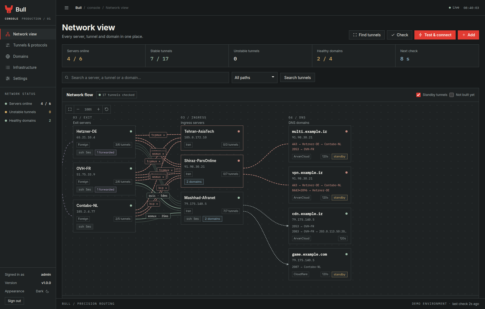
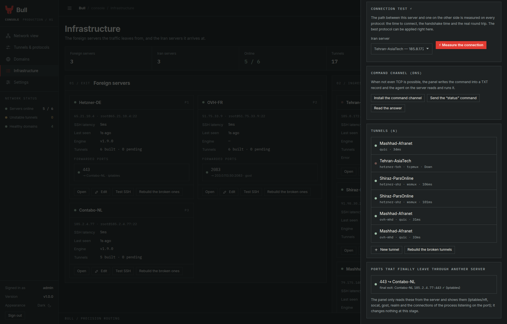
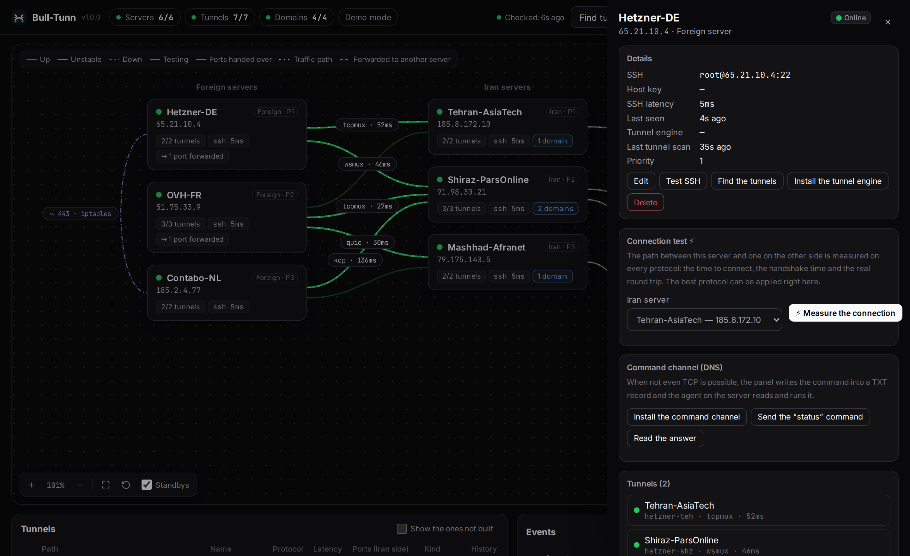
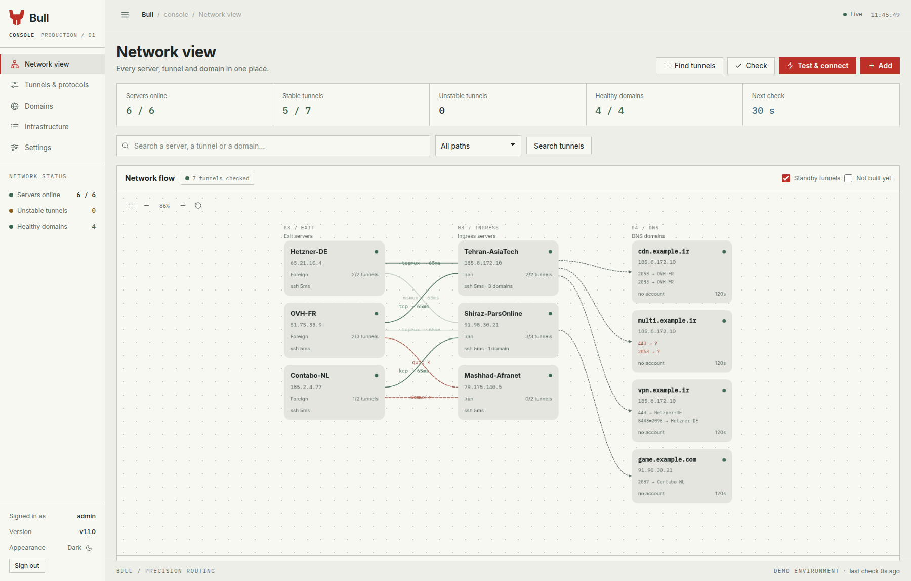

<p align="center">
  
</p>

**A control panel for reverse tunnels between Iranian and foreign servers.**

It builds the tunnels, measures their health end to end, moves a domain's
record to a healthy server when one dies, and reports every step to
Telegram. The tunnel engine, the panel, the management command and the
contract between them are all defined in this repository; it depends on no
outside project.

```bash
curl -fsSL https://raw.githubusercontent.com/Liwyd/bull-Tunnel/main/deploy/install.sh | sudo bash
```



## Contents

- [What it is](#what-it-is)
- [Install](#install)
- [The first run](#the-first-run)
- [How the pieces fit](#how-the-pieces-fit)
- [The dashboard](#the-dashboard)
- [Where the secrets are](#where-the-secrets-are)
- [Running it as a service](#running-it-as-a-service)
- [Developing it](#developing-it)
- [Licences](#licences)

## What it is

bull-Tunnel keeps two things apart:

| | What it is | Where it runs | If it breaks |
|---|---|---|---|
| **The data plane** | The tunnel engine: the tunnel itself and the user traffic | On both servers of a tunnel | Only that tunnel goes down |
| **The control plane** | The panel: building, measuring, failing over, DNS, reporting | On one server outside Iran | No tunnel goes down |

The panel is never in the traffic path. Switch it off and the tunnels keep
working exactly as before.

A domain points at an Iran server by its DNS record. Each of that domain's
ports can take its own tunnel to a different foreign server. When a tunnel,
a server or a port fails, the panel moves the record to an Iran server that
has every port of the domain healthy, and moves it back once the primary has
been stable for ten minutes. Every step is reported on Telegram.

## Install

Put the panel on a server **outside Iran** — one of the foreign servers, or a
separate one. It must be able to reach the Telegram API, the ArvanCloud and
Cloudflare APIs, the source of the tunnel engine and every server over SSH.
Ubuntu 22.04 or later. The panel is a static binary: no Python, no pip, no
dependency on the server.

### One line

```bash
curl -fsSL https://raw.githubusercontent.com/Liwyd/bull-Tunnel/main/deploy/install.sh | sudo bash
```

That is the whole installation. The script fetches the panel, puts it in
`/opt/bull-tunnel`, makes a `bulltunnel` user for it, starts the service,
opens the management tool, and prints the address of the panel and the
password of the `admin` user.

The default port is 8080. If the port is taken, the script stops before it
changes anything. To choose another port:

```bash
curl -fsSL https://raw.githubusercontent.com/Liwyd/bull-Tunnel/main/deploy/install.sh | sudo BT_PORT=9090 bash
```

The script is safe to run again on a live panel: the code is swapped while
the service is stopped, and the data directory (the state, the logins, the
backups) is never touched.

### From a checkout

```bash
git clone https://github.com/Liwyd/bull-Tunnel.git
cd bull-Tunnel
sudo bash deploy/install.sh
```

### With Docker

```bash
docker run -d --name bull-tunnel \
  -p 8080:8080 \
  -v bull-tunnel-data:/data \
  -e BT_PORT=8080 \
  liwyd/bull-tunnel:latest
```

The image is built by the CI and published on Docker Hub (`liwyd/bull-tunnel`,
amd64 and arm64). For the other versions: `liwyd/bull-tunnel:v1.0.0`. The data
stays in the volume named `bull-tunnel-data`; to change the password:

```bash
docker exec -it bull-tunnel bull-tunnel --data /data passwd
```

> If the image is not on Docker Hub, build it yourself with
> `docker build -t bull-tunnel:local .` — or install the panel directly on a
> server, which is what the one-line installer does.

### The panel on a domain with HTTPS

1. Create an A record that points at the IP address of the panel server, for
   example `panel.example.com`. **Turn the proxy/CDN off for this record.**
2. Open ports 80 and 443 in the firewall of the server (and of the provider's
   panel).
3. Run:

```bash
cd ~/bull-Tunnel
sudo bash deploy/https.sh panel.example.com you@example.com
```

The script checks that 443 and 80 are free and that the domain really points
at this server — if not, it stops **without changing anything** and says what
is in the way. It then gets a certificate from Let's Encrypt (port 80 is used
for only a few seconds while it is issued and renewed), brings the panel up on
443 with HTTPS, and sets up the automatic renewal. If the panel does not come
up on 443, it puts the previous settings back.

### Migrating from the previous panel

If the previous panel is installed on your server, do these two steps. Nothing
is deleted and everything can be undone.

On the panel server (from the new checkout):

```bash
git clone https://<user>:<token>@github.com/Liwyd/bull-Tunnel.git && cd bull-Tunnel
sudo bash deploy/migrate.sh
```

The data (servers, tunnels, domains, DNS accounts, the login) is moved, the
variables are renamed from `TM_` to `BT_`, and the `bulltunnel` service is
started. The previous service stays disabled until you are sure.

On each tunnel server (the Iran and the foreign servers):

```bash
scp deploy/remote-migrate.sh root@<server>:/tmp/
ssh root@<server> 'sudo bash /tmp/remote-migrate.sh'
```

This script only moves and rewrites files; it does not delete anything:

| Before | After |
|---|---|
| `/etc/backpack/` | `/etc/bull-tunnel/` |
| `backpack-<name>.service` | `bull-tunnel-<name>.service` |
| `/usr/local/bin/backpack` | `/usr/local/bin/bull-tunnel-engine` |

After this, press "Find tunnels" in the panel: the existing tunnels are
accepted and managed with the same names and settings as before.

## The first run

The installer opens the management tool. It runs on the machine the panel runs
on and needs no password: the panel wrote a key for it, in a file only the
owner of that machine can read, and the panel accepts the key only from this
machine.

```bash
bull-tunnel              # the menu
bull-tunnel status       # the state of the panel in one screen
bull-tunnel doctor       # is everything where it should be
```

```
bull-Tunnel 1.1.0
─────────────────
  panel              http://127.0.0.1:8080
  servers            3 of 3 online
  tunnels            4 up, 0 unstable, 0 down, 1 not built
  domains            2 of 2 healthy
  mode               acting
```

The menu has everything an operator does day to day: the servers (add, test,
remove), the tunnels (build, rebuild, remove), the domains (add, switch,
sync), the DNS accounts, the tunnel engine on the servers, the backups, the
service, the log and the admin password.

To bring up a real network:

1. **Add the servers:** the IP address and SSH. The running tunnels are found
   automatically — only the tunnels whose service is actually running are
   added.
2. **Install the tunnel engine** on every server that has a tunnel: server →
   "Install the tunnel engine".
3. **Add a DNS account** (Settings → DNS accounts) and press "Test".
4. **Add the domains.** The panel reads the current record and takes that Iran
   server as the "primary". The record is not touched.
5. In the panel of each domain, **tick the ports the domain uses.**
6. **Stay in observe mode for a few days.** The panel says on Telegram "what it
   would have done". Once you trust its proposals, switch observe mode off in
   the settings.

The guards that are always on:

- The first rewrite of the config of an existing tunnel keeps the original in
  `/etc/bull-tunnel/<name>.toml.bt-orig`.
- No tunnel is built on a port that is in use.
- "Test & connect" only builds the tunnels that are not built yet or are
  completely down; it never touches a healthy or an unstable tunnel.
- A failover only happens for a reason: several errors in a row, not a single
  transient one.

### The DNS provider keys

**Cloudflare:** Profile → API Tokens → Create Token → the **Edit zone DNS**
template. Pick the domains in Zone Resources (or All zones) and enter the token
in the panel.

**ArvanCloud:** access is granted on a **resource**, not on the user:

1. Profile → IAM → the list of machine users: create a machine user. Get a key
   from the "access keys" menu.
2. IAM → **resource and access management**: pick the domain in the CDN
   section. Create an access rule with a role that **reads and writes** DNS, and
   make the machine user a member of it.
3. In the panel, set the Zone to the root domain (for example `example.com`,
   not `panel.example.com`).

> The error `HTTP 403: Your access to this section is restricted` means step 2
> has not been done, or that the ArvanCloud account is limited (an unpaid bill,
> for instance). The panel tries again every 5 minutes and does not touch the
> record until it can read it.

### The Telegram bot

In the settings, enter the bot token (from
[@BotFather](https://t.me/BotFather)) and the Chat ID. If you do not know the
Chat ID, send `/start` to the bot. If Telegram is not reachable from the panel
server, the address of a reverse proxy or a SOCKS proxy can be given as well.

| Command | What it does |
|---|---|
| `/status` | The state of every server and domain |
| `/domains` | Where each domain is right now and which path its ports take |
| `/links` | The state of the tunnels |
| `/check` | Check everything right now |
| `/scan` | Look for the tunnels on the servers again |
| `/backup` | A backup right now |

## How the pieces fit

```
   user ──► Iran server ──► tunnel ──► foreign server ──► the real service
              (public IP)

   panel ──SSH──► Iran server        panel ──HTTPS──► Cloudflare / Arvan
   panel ──SSH──► foreign server     panel ──HTTPS──► Telegram
```

The panel keeps **one SSH connection** open per server and does all of its work
over that same connection: writing the config, starting and stopping the
service, measuring the health, reading the NAT rules. The full explanation:
[docs/architecture.md](docs/architecture.md).

**The state file.** Everything the panel knows is one JSON file,
`<data>/state.json`, written atomically and readable only by its owner. Every
writer takes the same lock, and every question the panel asks its state is
asked under it.

**The tunnel engine** is the data plane. It is one static binary, built for
amd64, arm64, 386 and armv7, and the panel builds it, ships it, versions it
and installs it on the servers that carry the tunnels. What it does:

- **An encrypted session on every carrier:** the two ends authenticate each
  other with a shared token, the traffic keys come from an X25519 exchange
  stretched with HKDF-SHA256 (so a recording of the traffic cannot be read
  later), and every frame is sealed with AES-256-GCM.
- **Several streams over one connection:** every opened port is an independent
  stream with a window of 64 KB (4 MB for the session), so one slow reader
  cannot make the memory grow without a bound.
- **The carriers:** `tcp`, `tcpmux`, `stealth` (a Noise record layer with no
  fingerprint for inspection to match), `ws` and `wss` (websockets over HTTP
  and over TLS), `wsmux` and `wssmux` (the same, multiplexed), `kcp` (a
  reliable protocol over UDP) and `quic` (the same, with its own TLS 1.3). The
  panel never tests a carrier the engine does not have: the engine prints the
  ones it speaks with `-v`, and the panel reads them from there.
- **Path measurement (`probe`):** the engine measures the path itself on every
  carrier and says which one is the fastest — what the ⚡ button in the panel
  shows. The measurement opens the carrier the way the tunnel's own client
  opens it and closes it again without claiming the control channel, so it
  never takes the tunnel away from the client carrying the traffic.

The engine and the panel are one Go module — `github.com/Liwyd/bull-Tunnel` —
with two binaries and the engine's own tree under `internal/engine/`. They are
synchronized by contract, not by linking: the panel reads the engine's files and
drives the engine over SSH, and never imports a package of it. That is what
keeps the MIT licence of the panel and the AGPL-3.0 of the engine apart.

The full contract of the engine (config, unit, metrics file, health probe,
session and the list of carriers): [docs/engine-schema.md](docs/engine-schema.md).

Installing the engine on a server:

- From inside the panel: server → "Install the tunnel engine". The panel
  downloads the file, **checks its SHA-256** and puts it on the server over SSH
  (the servers inside Iran usually have no access to GitHub).
- The source of the engine is configurable (a mirror or a private host, for
  example). For a private repository, the token goes in the same place.
- If the source is not reachable, put the file
  `bull-tunnel-engine_linux_<arch>.tar.gz` by hand in `<data>/cache/<version>/`;
  the panel picks it up.
- Building from the source: `bash build.sh` (no internet needed, because the
  dependencies are inside `vendor/`).

**The failover logic.** All the tunnels are always connected and ready. The A
record of a domain points at the Iran server of the tunnel that is in use.

| What happens | What the panel does |
|---|---|
| One of the tunnels of a port goes down but the Iran server is healthy | That port is handed over to another tunnel on the same Iran server (for example another foreign server). The DNS is not touched. |
| The Iran server has a problem, or it keeps dropping (by default: 3 drops in 10 minutes) | The record moves to the first Iran server that has **all the ports of the domain** healthy. |
| The record was changed | The panel checks the public resolvers and says after how many minutes the new server is behind the domain. |
| The tunnel is down but both of its servers are healthy | The tunnel is rebuilt with other protocols. This can be switched off with "automatic repair" in the settings. |
| The primary server is fixed | After **10 minutes of complete stability** the traffic goes back. Any drop in that window starts the count again. |

Every step is reported on Telegram: "the first server has a problem", "the
record was changed", "after X minutes the second server is behind the domain"
and "back to the primary server".

> **How is the health measured?** Every tunnel the panel builds or rewrites gets
> a loopback-only probe port on the Iran server that reaches the SSH of the
> foreign server. The panel reads the SSH banner from inside the tunnel, which
> means the whole real path works. The existing tunnels are measured from the
> report of their own engine and their established connections until the first
> rewrite.

**The final exit of a port.** Some ports are sent to another server after they
reach the foreign server, so that the exit IP address is different. Every minute
the panel **only reads** on each foreign server what happens to each port: the
DNAT rules in iptables or nftables, the program listening on the port (socat,
gost and realm are read from their command lines; haproxy, nginx, an xray relay
and the rest from their own connections), and the destination in the engine's
own config, for example `443=1.2.3.4:443`. The result is shown on the canvas
with a dashed purple line, and in the domain as `443→DehAds↪USA`. If the
destination does not answer, it is reported on Telegram. **No decision and no
change is made on the basis of this step.**

<p align="center"></p>

**The command channel (DNS).** When not even a TCP handshake is possible, SSH is
useless and the panel cannot do anything with that server. The command channel
is the way around it:

```
panel ──HTTPS──► DNS account ──► TXT record ──DNS──► agent on the server
panel ◄──HTTPS── DNS account ◄── TXT record ◄──DNS── agent
```

The panel writes the command into a TXT record and **signs it with a key that
only the panel and the agent know** (HMAC-SHA256), so an account that can write
in that zone still cannot forge a command. The agent on the server
(`bull-tunnel-engine agent`) reads that record every 30 seconds with an ordinary
DNS request, checks the signature and runs the command. There are only two
commands: `status` and `restart`. **There is no shell anywhere near it**, and
the name of the tunnel is checked twice: it must have the right shape and it
must exist on that server. The answer is written into another TXT record and
read by the panel.

**Requirement:** a separate zone with a separate account (for example
`bt.example.ir`). A server that has failed must not be able to touch the
records of the main domains. To set it up: in the settings, switch the "command
channel" on and pick its DNS account. Then, in the panel of each foreign
server, press "Install the command channel".

## The dashboard

One page with a sidebar, in two themes (charcoal and mineral paper). Every page
follows the same grammar: a title, a strip of counters, numbered sections and a
1px line instead of a shadow. Every number, protocol and address is set in a
monospace face, so a column of figures reads at a glance.

| Page | What it is for |
|---|---|
| **Network view** | The whole network as a graph: the foreign servers on the left, the Iran servers in the middle, the domains on the right. Free zoom and dragging, the layout is saved. Below it: the tunnel list and the event log. |
| **Tunnels & protocols** | Every path between an Iran server and a foreign server, with the carrier it speaks, its latency and the ports it carries. |
| **Domains** | The record, the ports it uses, the routes of every port and the order in which the Iran servers take over. |
| **Infrastructure** | The servers: their SSH, the tunnel engine on them, their tunnels and the ports they forward. |
| **Settings** | The working mode, the monitoring and the failover, the discovery of the tunnels, the DNS accounts, Telegram and the backups. |

The **line** of a path in the graph is its state, and its shape says it even
without a colour: a solid line is a connected tunnel, a long dash an unstable
one, a short dash a broken one, a dash and a dot a tunnel that is being tested,
a directed dash a port forwarded to another server, and a directed dotted line
the route of a domain. A selection is never a different colour but a red edge.

The **connection test** (⚡, in the panel of each server) measures the path
between that server and one on the other side, on every protocol: the time to
connect, the handshake time and the **real round trip** over the very path the
tunnel goes through. The panel sorts the results and proposes the fastest
protocol that works; "Apply" on the tunnel pins it. The measurement has to be
made on the servers themselves — from the outside, the panel cannot know how
good the path is. If the Iran server does not have a tunnel yet, there is no
port to measure and the panel says so.

<p align="center"></p>

<p align="center">
  
</p>

## Where the secrets are

- **The state file** (`<data>/state.json`, mode 0600) holds the servers' SSH
  passwords and the DNS provider API tokens **in the clear**. Anyone who can
  read that file has everything in it. The file lives under `/var/lib/bull-tunnel`,
  which the installer creates mode 700, owned by the `bulltunnel` user.
- **The admin password** is stored as a PBKDF2-SHA hash with a 16-byte random
  salt and 200,000 iterations — never in the clear, in the login file.
- **The backup** holds everything in the state file, so it is encrypted with
  AES-256 under a "backup password" you set yourself. **Without that password
  the backup cannot be opened.** Keep a copy of the password somewhere else.
- **SSH host keys** are pinned when the panel adds a server: the key it saw
  first is the key it checks every later connection against. Removing a server
  from the panel forgets that key.

Every night at **3 a.m. Tehran time** a full backup is sent to the Telegram
chats; the last 14 copies also stay in `<data>/backups`. The time, the time
zone and the number of copies are configurable in Settings → Backups.

- **A backup right now:** the "Send a backup now" button, the `/backup` command
  in the bot, or "Download the backup".
- **Restoring from the panel:** Settings → Backups → "Restore a backup…". Give
  it the file from Telegram or pick one of the copies on the server. The current
  state is backed up before it is replaced, nothing is changed on the servers or
  in the DNS records, and the panel comes up in observe mode and checks
  everything again.
- **Restoring on a new server** (for example if the panel server was lost):

```bash
git clone https://<user>:<token>@github.com/Liwyd/bull-Tunnel.git && cd bull-Tunnel
sudo bash deploy/install.sh
sudo systemctl stop bull-tunnel
sudo -u bulltunnel /opt/bull-tunnel/bin/bull-tunnel backup restore \
     bt-backup-XXXXXXXX-XXXX.tmbk --password 'the backup password'
sudo systemctl start bull-tunnel
```

With `--with-env` the port and the HTTPS settings come back as well. If the
domain of the panel has changed, run `https.sh` instead.

## Running it as a service

The installer starts the panel as the `bulltunnel` service. The paths:

| Path | What it holds |
|---|---|
| `/opt/bull-tunnel` | The program, the management tool and the tunnel engine |
| `/var/lib/bull-tunnel/state.json` | All the information of the panel (mode 600) |
| `/var/lib/bull-tunnel/backups/` | The copies of the backups |
| `/etc/default/bull-tunnel` | The port, the address and the path of the HTTPS certificate |
| `journalctl -u bull-tunnel` | The log of the panel |

The environment is read from `/etc/default/bull-tunnel`; every variable also
works on the command line:

| Variable | What it sets | Default |
|---|---|---|
| `BT_HOST` | The address the panel answers on | `0.0.0.0` |
| `BT_PORT` | The port the panel answers on | `8080` |
| `BT_DATA_DIR` | The directory the panel keeps its files in | `/var/lib/bull-tunnel` |
| `BT_SSL_CERT` / `BT_SSL_KEY` | The paths of the HTTPS certificate and key | — |
| `BT_NO_MONITOR` | `1` stops the monitor: the panel answers but does not watch or fail over | — |
| `BT_DNS_PROXY` | A proxy for the DNS requests | — |

The same settings are flags: `--host`, `--port`, `--data`. The other flags are
`--demo` (a simulated network, no server needed), `--check` (ask the panel's
own API and say whether it answers, then exit) and `--static-dir` (serve the
dashboard from another directory).

To change the password:

```bash
sudo -u bulltunnel /opt/bull-tunnel/bin/bull-tunnel passwd
```

The panel is started by the service, and it can be started by hand the same
way:

```bash
sudo -u bulltunnel /opt/bull-tunnel/bin/bull-tunnel-panel --data /var/lib/bull-tunnel
```

To update:

```bash
cd ~/bull-Tunnel && git pull && sudo bash deploy/install.sh
```

Only the panel service is restarted. The tunnels, the users and the settings
are not touched.

A few details worth knowing:

- The tunnels the panel builds are named `bt-<id>`, and the existing tunnels
  keep their own name. On the servers: the config in
  `/etc/bull-tunnel/<name>.toml`, the service `bull-tunnel-<name>.service`.
- When an existing tunnel is rewritten, only the protocol, the token, the ports
  and the probe port are changed; the other keys, such as `mux_*` and
  `bind_addr`, are left alone.
- "Forgetting" a tunnel only removes it from the panel; the tunnel stays on the
  server.
- The interface is plain HTML, CSS and JavaScript: no build step, no framework,
  no bundler. The stylesheet and the script are served with
  `Cache-Control: no-cache`, so a new version of the panel is never mixed with
  the files of the old one in a browser.

## Developing it

The panel is Go, built and tested with the Go toolchain. The dependencies are
vendored, so the build needs no network. The five commands that verify a change:

```bash
go vet ./...
go test -race ./... -skip 'TestStartDoesNotReturnUntilThePortsAreFree|TestWriteBatchDoesNotAllocatePerCall|TestAnExplicitServerNameIsNotRewritten'
node --check static/app.js
bash tests/install-check.sh
go run ./cmd/bull-tunnel-panel --demo --data /tmp/panel-demo --port 18080
```

The demo mode does not connect to any server: it builds a simulated network and
breaks something every minute so the failovers can be watched live. The panel
answers on <http://127.0.0.1:8080> with six servers, two DNS accounts and four
domains, and the tunnels that were "set up by hand" before the panel existed
are found by the first scan and adopted.

The three tests the race run skips are timing-sensitive tests of the engine's
upstream code; the CI re-runs each of them up to five times.

What changed in every version is in [CHANGELOG.md](CHANGELOG.md). The design
decisions, the transport behaviour under filtering and the scale limits are in
[docs/architecture.md](docs/architecture.md).

## Licences

The **control panel** — everything outside the `internal/engine/` directory — is
MIT licensed.

The **tunnel engine** in the `internal/engine/` directory is licensed under the
GNU Affero General Public License v3.0 (`internal/engine/LICENSE`,
`internal/engine/NOTICE`). It is an inherited engine, and the credit for that
belongs where the licence asks for it:

```
Based on BackPack by Amin Mohammadi (AminMGMT)
https://github.com/AminMGMT/BackPack
```

The two are separate programs — the panel drives the engine over SSH and never
links a package of it — so each keeps its own licence. The name and logo of the
engine's originator are marks of their owner and are not licensed with this code
(`internal/engine/TRADEMARK.md`); this project has its own name and its own
logo.
